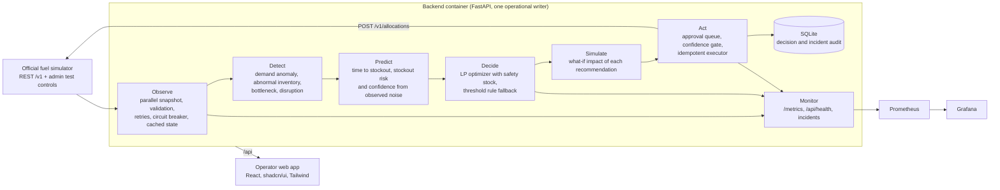

# Fuel Supply Intelligence & Resilience Platform

An operations platform for the BUP CSE Fest 2026 fuel supply simulator. It watches the simulated Bangladesh fuel network, predicts shortages, recommends and sends allocations, explains each decision, and keeps working when parts of the system fail.

Everything runs locally against the official simulator image (`asifmahmoud414/bup-fuel-supply-simulator:1.0.0`, unchanged). Progress, measured results, and design decisions are in [`devlog.md`](devlog.md). The full plan is in [`BUP_Fuel_Supply_Deterministic_MVP_Full_Plan2.md`](BUP_Fuel_Supply_Deterministic_MVP_Full_Plan2.md).

## Run it

Requirements: Docker with Compose v2.

```bash
cp .env.example .env
docker compose up -d --build
```

| What | Where |
|---|---|
| Operator application | http://localhost:8100 |
| Grafana dashboard (anonymous view) | http://localhost:3000 |
| Prometheus | http://localhost:9090 |
| Simulator API (direct) | http://localhost:18000/docs |
| Backend health (JSON) | http://localhost:8100/api/health |
| Backend metrics | http://localhost:8100/metrics |

The simulator starts paused. Start its clock from **Incidents and lab → Run**, or set `SIMULATOR_START_MODE=running` in `.env`. At the default speed one simulated day passes in 12 seconds; for a human-paced demo set `SIMULATION_SPEED=1` (one day ≈ 96 s).

Stop with `docker compose down` (add `-v` to also delete the decision history volume).

### Configuration (`.env`)

| Variable | Default | Meaning |
|---|---|---|
| `SIMULATION_SPEED` | 8 | Simulator ticks per real second |
| `TICK_MINUTES` | 15 | Simulated minutes per tick |
| `SIMULATOR_START_MODE` | paused | `paused` or `running` |
| `SIM_PORT` / `APP_PORT` | 18000 / 8100 | Host ports (8000 is often reserved on Windows) |
| `FUELOPS_POLICY` | lp-buffer | Planner: `lp-buffer` (optimizer with safety stock), `lp`, `threshold` (rule fallback) |
| `FUELOPS_MODE` | manual | `observe` (read only), `manual` (operator approves), `auto` (confident recommendations are sent; low confidence waits for review) |
| `FUELOPS_OPERATOR_TOKEN` | empty | When set, lab controls, mode and planner changes require this token |
| `GRAFANA_ADMIN_PASSWORD` | change-me | Grafana admin login |

No secrets are stored in the repository. All ports bind to `127.0.0.1`.

## Architecture



Recovery paths: an unreachable simulator switches the backend to cached state (degraded) and it recovers automatically; invalid simulator data is rejected with an alert; switching the intelligence off hands allocation to the rule policy; low-confidence recommendations wait for an operator; a simulator reset (tick going backwards) starts a new run so old shipment intents never leak into the new world.

## Develop

```bash
python -m venv .venv && .venv/Scripts/pip install -r requirements.txt   # Windows path; use .venv/bin on Linux/macOS
.venv/Scripts/python -m pytest -q tests                                  # optimizer and resilience tests
.venv/Scripts/python -m uvicorn fuelops.api:app --port 8100              # backend against SIM_URL (default http://localhost:18000)
cd web && npm ci && npm run dev                                          # web app with /api proxied to :8100
```

Experiment tools (they reset the simulator):

```bash
.venv/Scripts/python -m fuelops.probes c01 c06                       # simulator contract probes
.venv/Scripts/python -m fuelops.harness threshold lp --ticks 672     # stepped benchmark, optional --recipe s04_primary_route_down
.venv/Scripts/python -m fuelops.hindsight reports/<run>_demand.json  # perfect-hindsight upper bound
.venv/Scripts/python -m fuelops.livetest none unavailable --policy lp-buffer   # live fault runs
```

Load test: see "Load testing" in `devlog.md` for the k6 command (`ops/k6/load.js`).

CI (`.github/workflows/ci.yml`): unit tests and web build, then the whole stack is deployed with Compose, health-checked, and smoke-tested.
